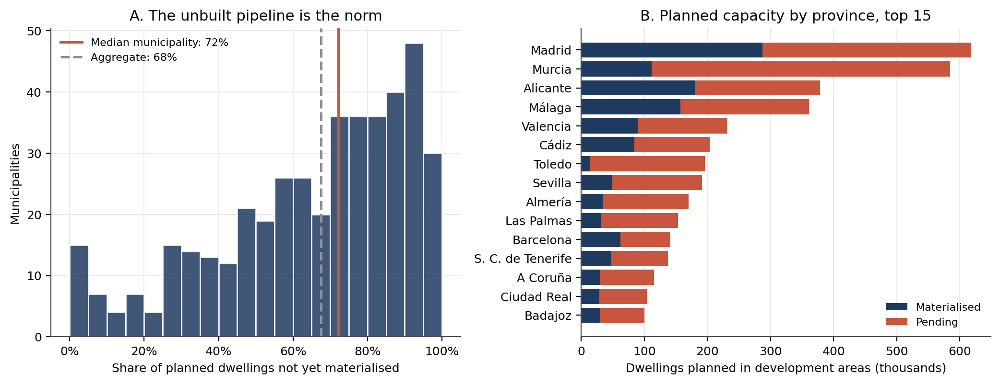
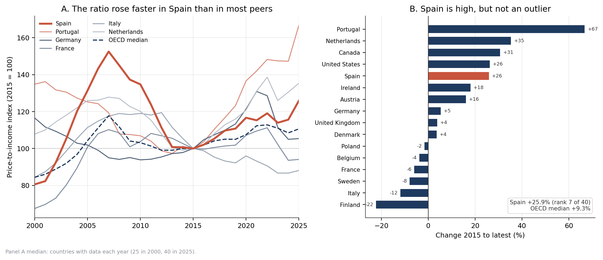
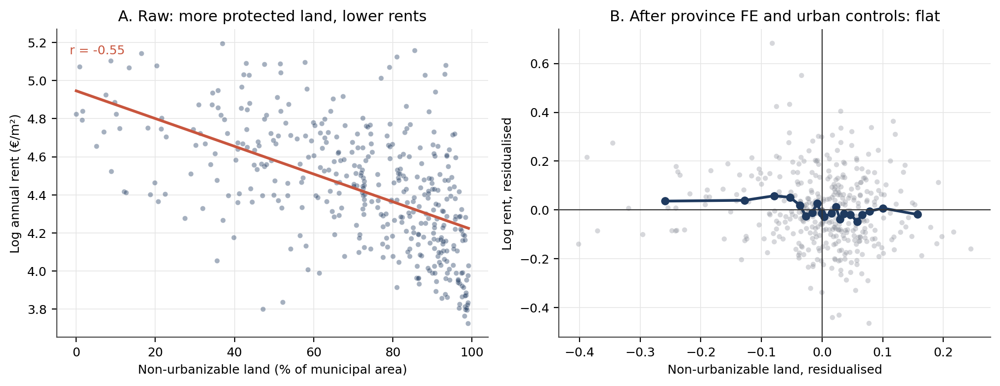

# Permission Without Construction

*Spain's planned-but-unbuilt housing pipeline, 431 municipalities, 2010-2025.*

[](https://github.com/magnumjpg/spain-housing-supply/actions/workflows/ci.yml) [](https://github.com/magnumjpg/spain-housing-supply/actions/workflows/ci.yml) [](https://www.python.org/) [](LICENSE) [](DATA.md)

**English** · [Español](#resumen-en-español) · [Data](DATA.md) · [Method](METHOD.md) · [Limitations](LIMITATIONS.md) · [Decisions](DECISIONS.md)

**Spain plans millions of homes that are never built, and the evidence does not show that classifying land raises rents.**

*MIVAU SIU · INE · SERPAVI · 431 municipalities · 2010-2025 · 41 tests*

---

## At a glance

- **Question:** is more land classified for development associated with lower municipal rents and prices in Spain, and how large is the planned-but-unbuilt housing pipeline?
- **Data:** MIVAU SIU land classification and pipeline for 431 urban municipalities, INE rents, prices and population 2010-2025, SERPAVI tax-record rents, and OECD/Eurostat comparators.
- **Method:** descriptive municipal cross-section and panel; the comparative chapter is a benchmark, not an identification strategy.
- **Headline:** 3.49 M pending dwellings in the 431-municipality matched sample; in the 359 with positive 2023-2025 net additions, 3.17 M pending equal 45.7 years at recent net additions (median 48.3, p75 136.3).
- **Caveat:** 45.7 is a central estimate of a heavily right-skewed distribution, not a bound or a forecast; all 396 stock-observed municipalities give 52.2 years, and the rent and price regressions are associational.

## Contents

- [1. The finding](#1-the-finding)
- [2. The rent question, in one paragraph](#2-the-rent-question-in-one-paragraph)
- [3. Municipal panel construction and benchmark architecture](#3-municipal-panel-construction-and-benchmark-architecture)
- [4. The headline numbers](#4-the-headline-numbers)
- [5. Is Spain unusual? A multi-country check](#5-is-spain-unusual-a-multi-country-check)
- [6. The rent test: what it can and cannot show](#6-the-rent-test-what-it-can-and-cannot-show)
- [7. Interpretation](#7-interpretation)
- [8. What this does not prove](#8-what-this-does-not-prove)
- [9. Literature and positioning](#9-literature-and-positioning)
- [10. Reproduce](#10-reproduce)
- [11. Files](#11-files)
- [12. Figures](#12-figures)
- [License](#license)
- [Author](#author)
- [Resumen en español](#resumen-en-español)

## 1. The finding

Spain's urban planning system gives municipalities the power to decide which land can be built on. The standard critique is that this power restricts the supply of land and pushes up rents. This relationship was tested empirically against official data.

**The rent test does not confirm it.** The rent section below explains exactly why, and the reason is informative rather than mysterious: a single municipal cross-section cannot separate land classification from the urban-rural gradient, and land classification is chosen by the municipality. That is a limit of this design, not evidence that planning does not matter.

But the same data show something larger, more concrete and fully measurable: **3.49 million dwellings are planned in development areas and have not been built in the 431-municipality matched sample.** In the 359 municipalities where stock is observed in both 2023 and 2025 and net additions are positive, the 3.17 million pending dwellings are equivalent to **45.7 years of construction** at the 2023-2025 net addition rate. That aggregate is a central estimate of a right-skewed distribution, not a typical municipality: the median is **48.3 years** (p75 136.3, p90 294.3), and **76%** have more than 20 years. Including all 396 municipalities with stock observed in both years gives **52.2 years** as the sample-sensitivity check.

That is the project. The pipeline is not a rounding error or a handful of stalled projects. It is decades of housing that exists on paper and not on the ground.

The supply side of the comparison points the same way: Spain permits **2.64 dwellings per 1,000 inhabitants**, against a European median of **4.62** and 28th of 33 countries. The price side is more mixed: Spanish price-to-income rose faster than most peers (7th of 40) but is still 17% below its 2007 peak. Both facts are in the comparative chapter below.

## 2. The rent question, in one paragraph

Do municipalities that classify more land have lower rents? **Not in this sample, once province and urbanization are held constant.** The raw correlation is −0.55, but that is mostly because the non-urbanizable share is a rurality index: rural places have cheap rents for reasons unrelated to planning. With urban controls, the association is a null. The two coefficients that are statistically distinguishable from zero are negative: more unbuilt capacity goes with *lower* rents, which is consistent with planning following demand rather than constraining it. Replicating the test with SERPAVI, an independent tax-based rent series, yields identical results. None of this identifies a causal effect; see the rent section below and `LIMITATIONS.md`.

## 3. Municipal panel construction and benchmark architecture

A municipal dataset that, as far as I can tell, did not exist as a single reproducible table, plus a cross-country benchmark:

- **Land classification**: the MIVAU *Sistema de Información Urbana* (SIU), 5,898 municipalities, with the share of municipal land in each class, the surface of development areas, planned dwellings, and dwellings still pending.
- **Outcomes**: INE *Indicadores Urbanos* (table 69330), 434 municipalities, 2010-2025, with annual rent €/m², mean and median rent, house prices, housing stock, vacancy, households and household size. A second outcome series, MIVAU **SERPAVI** (tax records, 2024), is used as an independent check on the rent result.
- **Demand controls**: INE Padrón (table 29005), municipal population 1996-2025.
- **Comparison**: OECD Analytical House Prices (40 countries), Eurostat building permits and population (34 and 33 countries), and Eurostat Urban Audit prices, rents and population (251 comparable cities in six countries). These are a separate chapter, not part of the municipal regression.

The Spanish municipal sources are merged on the 5-digit INE municipal code. The SIU match is 431 of 434 urban municipalities; all 431 have a SERPAVI rent. The comparison is built separately on ISO country and Eurostat city codes. Every headline number below is in `outputs/results.json`; the full country and city tables are in `outputs/tables/`.

## 4. The headline numbers

| | |
|---|---|
| Urban municipalities in the matched sample | **431** |
| Dwellings planned in development areas | **5.17 million** |
| Planned dwellings not yet materialized | **3.49 million (67.5%)** |
| Pending pipeline at the 2023-2025 construction rate | **45.7 years** (359 municipalities; 3.17 million pending) |
| Median municipality's years of pending supply | **48.3 years** |
| Municipalities with more than 20 years of pending supply | **76.0%** |
| Median municipality's pending share | **72.1%** |
| Planned capacity relative to existing housing stock | **33.4%** |
| Development land that has not started urbanization | **48.8%** (area-weighted) |
| Municipalities where more than 80% of planned dwellings are pending | **35.7%** |

The 45.7-year ratio uses the **3.17 million** pending dwellings in its 359-municipality positive-flow sample, not the full 3.49 million in the 431-municipality matched sample. The national pending stock is **7.09 million** (5,900 reporting municipalities), so 3.49 million is a matched-sample subtotal, not a national total.

The 5.17 million planned dwellings sit in 256,606 hectares of development land. If every pending dwelling were built, the housing stock of these 431 municipalities would grow by about **23%** (pending/stock is 22.6%); planned capacity is equivalent to **33.4%** of the existing stock. Two-thirds of the pipeline has not been materialized.

This is not a rural artifact. Madrid alone has 158,113 pending dwellings; Murcia 111,116; Toledo 88,698. Toledo's plan envisages more than twice the city's existing stock.



*Figure 1. Share of planned dwellings not yet materialized, by municipality (median 72%, aggregate 68%), and planned capacity by province, top 15. Source: `outputs/figures/fig1_pipeline_gap.png`.*

### How long is the pipeline?

The stock-over-flow ratio is the number that makes the gap interpretable. For each municipality with Catastro stock observed in both 2023 and 2025, I divide pending dwellings by the average annual net change in the conventional-dwelling stock. Across the 359 municipalities with positive net additions and positive pending:

- **3.17 million** pending dwellings;
- **69,411** net additional dwellings per year;
- **45.7 years** of pending supply at that rate;
- median municipality **48.3 years** (p25 20.9, p75 136.3, p90 294.3), a right-skewed distribution, so 48.3 is not "typical" in the sense of a central mass;
- **76.0%** of municipalities above 20 years, **49.6%** above 50 years.

The 2021-2025 window, on the 115 municipalities with continuous stock coverage over the longer period, gives **34.8 years**. The order of magnitude is robust to the window: decades, not years.

Two sample choices push the aggregate in opposite directions, so it is neither an upper nor a lower bound. The denominator is *net* additions, which subtract demolitions; that understates gross construction and raises the ratio. The positive-flow filter excludes 37 municipalities, 24 of them shrinking, which raises the summed denominator and removes **217,377** pending dwellings from the numerator; that lowers the aggregate. Including all **396** municipalities with stock observed in both years gives **52.2 years**, so the headline is a central estimate and 52.2 is the sample-sensitivity check, not a lower bound. Pending is also a stock, not a committed flow: some of it may never be built. The claim is not "Spain will exhaust this in 46 years"; it is "at recent construction rates, the pipeline is equivalent to four decades of supply". That is enough to reframe the policy question from "how much land is classified" to "why the classified capacity is not being converted".

### External check

MIVAU publishes its own national aggregate for the same source. Across **5,900 reporting municipalities** it counts **9.60 million planned dwellings and 7.09 million pending**, a pending share of **73.9%**, with **55.9%** of development land not started.

The 431 municipalities analyzed here account for **53.8% of that national planned capacity** and 49.2% of the pending stock. So this is not a niche sample, and it is not a different universe: the national pipeline is, if anything, slightly *more* unbuilt than the urban one. The 5.17 million figure is a subset of the 9.60 million, not a competing estimate.

## 5. Is Spain unusual? A multi-country check

A pipeline measured in decades needs a distribution. The Spanish data cannot tell
us whether 45.7 years is a lot. The comparative chapter therefore places Spain
against other countries on the two margins that can be harmonized with public
data: **how fast prices moved**, and **how many dwellings were permitted**.

It is a descriptive chapter, not a second identification strategy. No
cross-country measure of planned-but-unbuilt dwellings exists, so the 45.7-year
ratio stays Spanish. The comparison dimensions the flow and the price outcome.
Method in `METHOD.md` §7, units and coverage in `DATA.md` §6, caveats in
`LIMITATIONS.md` §11.

### Prices: high, but not an outlier

| Measure (index, 2015 = 100) | Spain, 2015→latest | Median, same sample | Spain's rank (1 = highest) |
|---|---:|---:|---:|
| Price-to-income | **+25.9%** | +9.3% | **7th of 40** |
| Price-to-rent | **+58.9%** | +30.3% | **10th of 42** |
| Real house price | **+43.0%** | +38.0% | **15th of 40** |

The endpoint is not the same for every country: 36 of the 40 price-to-income
series end in 2025, while Israel ends in 2016, Iceland and Russia in 2019 and
Colombia in 2024. Holding the endpoint at 2025 gives a median of **+10.6%** on 36
countries rather than +9.3% on 40; Spain stays 7th. The benchmark is not an
artifact of the mixed endpoints, but it is a mixed-endpoint median and is labeled
as such. The real-price row is the median of the **40-country price-to-income
sample**, not of the 47 countries with a real-price series (that median is +37.0%).

Over the longer window, Spain's price-to-income ratio is **+56.3%** since 2000,
against a median of **+23.7%** (5th of 25; only 25 of the 40 countries have a 2000
observation).

Spain is high, but it is not the top: Portugal (+66.7%), the Netherlands (+35.3%),
Canada (+30.7%), Czechia (+28.5%) and the United States (+26.3%) are above it.
Hungary (+26.1%) is 0.2 points above Spain and Switzerland (+24.8%) is 1.1 points
below. The rank is reported with its n because it is fragile to revisions.

The comparison also needs its own history, because a ratio can be above the
40-country median and below its own peak. All three Spanish ratios peaked in **2007**:

- price-to-income is **17.4% below** its 2007 peak;
- price-to-rent is **1.9% below** its 2007 peak;
- real house prices are **12.8% below** their 2007 peak.

The three disagree because their denominators moved differently. The project
reports them side by side and does not decompose price-to-income into rents and
incomes: the OECD rent index is a national deflator, not the municipal market rent
series used in the rest of this project.



*Figure 8. Spanish price-to-income against five peers and the country median, plus the cross-country distribution of 2015-to-latest changes. Source: `outputs/figures/fig8_price_to_income.png`.*

### Supply: low, and far below its own boom

| Window | Spain, dwellings per 1,000 | European median | Spain's rank (1 = highest) | Countries |
|---|---:|---:|---:|---:|
| 2015-2019 | **1.40** | 4.12 | **31st of 34** | 34 |
| 2021-2024 | **2.64** | 4.62 | **28th of 33** | 33 |

The 2021-2024 average, **2.64**, is **57%** of the current European median and
**16%** of the 2006 peak of 16.70. The 2024 single year is **3.69**, 80% of the
median and 22% of the peak. The two statements use different numerators and the
text keeps them apart.

The coverage is 34 and 33 countries, not the 38 that the raw Eurostat geography
list suggests: Bosnia has no Eurostat population series, the UK permit series ends
in 2019, and Kosovo's population ends in 2022. 2025 is excluded because Eurostat's
2025 values are preliminary: Spain's is exactly 200.0 thousand against 179.4
thousand in 2024.

Permits are not completions. They lead construction and can be delayed or
abandoned. The chapter uses them because they are the only annual,
country-comparable flow measure, and it does not use them to estimate the Spanish
pipeline.

### Cities: not the most expensive relative to rent

The city layer covers **251 comparable cities in six countries**, of which **87 are
Spanish**. The measure is the average apartment purchase price divided by average
annual rent per m²: years of gross rent, not affordability.

| Country | Cities | Median price-to-rent (years) |
|---|---:|---:|
| Finland | 9 | 13.41 |
| Lithuania | 5 | 15.34 |
| **Spain** | **87** | **16.56** |
| Portugal | 16 | 20.81 |
| Croatia | 7 | 21.32 |
| Germany | 127 | 29.48 |

Spain's median city is **16.56 years** (p25 14.84, p75 18.59), **4th of 6** on a
rank where 1 is the highest price-to-rent. That is the lower half of the
six-country sample. Madrid is 22.13, Barcelona 23.15, Valencia 17.81, Sevilla
17.44, Málaga 19.27, Palma 24.80 and Eivissa 28.83.

This is a genuine counterweight to the Spanish story: on this measure, Spanish
cities are **not** the most expensive in the sample. German cities are far more
expensive relative to rent. A low price-to-rent can mean cheap housing or expensive
rents; the chapter does not interpret it as affordability. France, Italy and the
Netherlands have no comparable rent series; Latvia is excluded because its four
cities are internally inconsistent; the comparable years span 2022-2025, with
Spain at 2023 and Germany at 2022.

One caveat on the geography: Eurostat publishes some cities as **greater-city**
aggregates rather than strict municipal boundaries. That is true of **44 of the 251**
comparable cities, including Madrid, Barcelona and Valencia, **25 of the 87** Spanish
cities and all 16 Portuguese ones. Each ratio uses price and rent from the same
geography, so the ratio is internally consistent, but a "city" median here mixes two
spatial definitions.

The conclusion is sample-dependent, and the sensitivity is reported rather than
buried. Dropping greater-city units leaves **207 cities in five countries**
(Portugal has no municipal-boundary city in the source), lowers Spain's median to
**16.06 years** and moves it to **3rd of 5**, the median of the smaller sample, not
its lower half. Germany (29.35) and Croatia (21.31) remain above Spain; Lithuania
(15.34) and Finland (13.41) below. The robust statement is therefore "not the most
expensive relative to rent", not "cheap".

### What the comparison changes

It narrows the claim. Spain is **not** an extreme on price growth (7th of 40, and
below its own 2007 peak on price-to-income) and **not** an extreme at city level on
price-to-rent (4th of 6; 3rd of 5, i.e. at the median, on municipal boundaries only).
It is **near the bottom on the supply flow**: 2.64 dwellings per 1,000, 28th of 33,
and 16% of its 2006 peak on the 2021-2024 average.

Low building permits and a large stock of planned-but-unbuilt dwellings are
different measurements, but they point to the same margin: converting planned
capacity into construction. The chapter cannot prove that with a cross-country
comparison, and it does not try. It says Spain is a high-price-growth,
low-permitting country; the price outcome is not extreme, the supply flow is near
the bottom of the European distribution.

## 6. The rent test: what it can and cannot show

Read this section as a failed identification, not as the project's main result. It is here because the hypothesis was stated first and the null is part of the answer.

### 6.1 The raw correlation runs the wrong way

Municipalities with a larger share of non-urbanizable land have **lower** rents, not higher: the raw correlation with log rent is **−0.55**. Municipalities with more development land have higher rents (**+0.30**). That is the opposite of the restriction hypothesis.

It is also almost certainly not a treatment effect. Non-urbanizable share is close to a measure of "how rural is the municipality". Rural places have cheap rents for reasons that have nothing to do with planning.

### 6.2 Once urbanization is held constant, the association disappears

Adding province fixed effects and controls for population, housing stock, population growth, density and the share of consolidated urban land:

| Measure (per 1 SD) | Association with log rent | p-value | n |
|---|---:|---:|---:|
| Share of non-urbanizable land | −4.6% | 0.21 | 402 |
| Share of development land | +1.5% | 0.45 | 402 |
| Planned dwellings per 1,000 existing | +3.9% | 0.09 | 401 |
| Share of planned dwellings pending | −2.3% | 0.008 | 400 |
| Share of development land not started | −2.3% | 0.026 | 402 |

The merged cross-section has 431 municipalities; the regressions use **400-403** because controls and outcomes are missing for some municipalities, mostly the rent outcome and the Catastro housing stock. The `n` column is the exact estimation sample, so not every regression uses 431.

None of the coefficients has the sign the restriction hypothesis predicts (positive for restricted land, negative for development capacity). The two that are statistically distinguishable from zero are negative: **more unbuilt capacity is associated with lower rents**, which is what you would expect if planning follows demand rather than constraining it.

The same sign pattern holds for prices. All five coefficients (per 1 SD, n = 401-403) are: non-urbanizable **−8.4%** (p = 0.21), development land **+5.1%** (p = 0.15), planned capacity **+6.6%** (p = 0.067), pending share **−2.6%** (p = 0.11) and unstarted development land **−2.2%** (p = 0.17). No price measure is significant at 5%; planned capacity is the only one below 10%, and its sign is positive, not the restriction sign. The gross yield tells a different story: development land is associated with a 3.4% lower rent-to-price ratio (p = 0.04), which is what you would expect if prices respond more strongly than rents, not if rents alone were being held up. Figure 4 shows the mechanism for rents: the raw slope is steep, and after province and urbanization controls the binned relationship is flat.



*Figure 4. Raw versus adjusted relationship between land classification and municipal rent. Source: `src/figures.py`; data: `outputs/results.json`.*

### 6.3 A second, independent rent series says the same thing

INE table 69330 is one measurement of rents. To check that the null is not an artifact of that series, I repeated the cross-section with **SERPAVI**, MIVAU's rent index built from *Modelo 100* income-tax declarations. It is a different operation, a different unit (median monthly rent per m² of collective residential buildings, not mean annual rent per m²), and a different sample frame.

All **431** municipalities have a SERPAVI rent. **406** also have an INE rent. The two agree closely in levels: Pearson **0.991** (0.992 in logs), and annualized, the median SERPAVI/INE ratio is **0.959** (p10-p90: 0.916-0.997), which is what a median-versus-mean comparison should look like. Agreement is a cross-source check, not a restatement: the series are not the same measurement.

With the same urbanization controls and province fixed effects, the tax-based series reproduces the INE result almost coefficient for coefficient:

| Measure (per 1 SD) | SERPAVI rent | p-value | n | INE rent (for comparison) |
|---|---:|---:|---:|---:|
| Share of non-urbanizable land | −4.0% | 0.27 | 403 | −4.6% |
| Share of development land | +1.1% | 0.57 | 403 | +1.5% |
| Planned dwellings per 1,000 existing | +3.5% | 0.15 | 402 | +3.9% |
| Share of planned dwellings pending | −2.4% | 0.003 | 401 | −2.3% |
| Share of development land not started | −2.2% | 0.031 | 403 | −2.3% |

The two variables that are distinguishable from zero remain negative. The restriction hypothesis does not reappear when rents are measured from tax records.

SERPAVI has its own limits: it excludes Navarra and the Basque Country (foral tax regimes), it is censored where the number of declarations is too small to publish, and its definition (collective residential buildings) drops part of the rental stock. Those limits are why it is a robustness check next to INE, not a replacement.

### 6.4 The panel does not rescue the hypothesis

I also estimated whether population growth passes through into rents more strongly where land is restricted, with municipality fixed effects and either year or province-year fixed effects. The interaction is never positive and significant:

- Non-urbanizable share × population growth: **−0.165** with province-year FE (p = 0.0036).
- Planned capacity × population growth: **−0.10** with year FE (p = 0.003), but **−0.03** (p = 0.24) once province-year shocks are absorbed.
- Pending share × population growth: indistinguishable from zero.

A negative interaction is consistent with supply responding where capacity exists, but it is fragile to regional shocks. I do not claim it as a supply-elasticity estimate.

### 6.5 Demand growth does not close the gap

Fast-growing municipalities do plan more: the top tercile of population growth has a median of 375 planned dwellings per 1,000 existing, against 309 in declining municipalities. But the pending share barely moves: **71.3%** in fast-growing places versus **75.1%** in declining ones. The pipeline is not a rural curiosity that demand would clear.

### 6.6 A competing explanation: plan vintage

There is a simpler reason why some places show a large pending stock. The SIU records the approval year of each municipality's general plan, and newer plans have had less time to be built out.

Median pending share falls monotonically with plan age: **85%** where the plan is five years old or less, **66%** where it is 21-30 years old, **58%** where it is more than 30 years old. The correlation between plan age and pending share is **−0.36**.

This is not a nuisance to be controlled away. It is a direct warning against reading the 3.49 million pending dwellings as obstruction: a municipality that approved a large expansion in 2022 *should* have almost all of it pending.

The counter-argument is that the aggregate is dominated by older plans. It is: **74% of the pending dwellings sit under plans approved more than 15 years ago**, and even the oldest plans still have 58% pending. So plan vintage explains part of the cross-sectional variation (and is reported rather than hidden), but it does not reduce the gap to a story about recent plans that have not had time to build.

## 7. Interpretation

The Spanish planning system produces a lot of **paper housing**: land classified, sectors drawn, dwellings counted, and a large share of it never converted into buildings. The observable bottleneck in these data is not the headline stock of classified land. It is the step between permission and construction.

That reframes the policy question. If the debate is about how much land is classified as urbanizable, the data suggest the debate is aimed at the wrong margin. The margin that shows up is execution: land assembly, infrastructure, financing, the sequencing of plan approval, and the incentives of landowners to build rather than hold. The data cannot tell us which of these dominates. They can tell us that the classification share is not a good proxy for the constraint.

It also explains why the naive cross-section is so misleading. Land classification is not assigned to municipalities; it is chosen by them, in response to demand, geography and politics. A municipality that expects to grow classifies land. A municipality that is rural, protected or shrinking does not. Regressing rents on that choice without a source of exogenous variation mostly recovers the urban-rural gradient.

## 8. What this does not prove

- **No causal effect of land classification on rents.** The design is cross-sectional and the treatment is endogenous. The null is not evidence that classification does not matter; it is evidence that this design cannot detect it.
- **The 45.7-year ratio is a description, not a forecast.** It divides a stock by a recent net flow. Two sample choices push it in opposite directions: netting demolitions raises it, while excluding shrinking municipalities lowers it, so it is not a bound in either direction. All 396 stock-observed municipalities give 52.2 years; demand can grow, plans can be revised, and part of the pending stock may never be built. It says "decades at recent rates", not "exhausted in 2050".
- **No corruption claim.** Nothing here measures corruption, influence or wrongdoing. The gap between planned and built housing is consistent with many explanations, including the 2008 crash, slow infrastructure, financing constraints and rational landowners.
- **The pending variable is a stock, not a delay.** `munnvivpnd` counts dwellings planned in development areas that have not been materialized at the date of the SIU image. It does not say when they were planned, or whether they were ever expected to be built soon.
- **The SIU is a snapshot.** Land classification is measured around 2020-2025, while rents run to 2024. Any panel design using this measure is compromised by the fact that the "treatment" is observed after part of the outcome.
- **The sample is urban.** 431 municipalities, not all 8,000. They are the INE urban-indicator municipalities, and they hold 15.5 million dwellings.
- **SERPAVI is a different, narrower measurement.** It covers collective residential buildings from tax records, excludes Navarra and the Basque Country, and censors small cells. It is used as an independent check on the INE rent null, not as a second estimate to average with the first.
- **Rent is not affordability.** I do not observe municipal household income, so I cannot compute rent-to-income. The outcome is rent per square meter.
- **The international comparison is a benchmark, not an identification.** It reports distributions and ranks across 33-42 countries; it does not estimate a causal effect of regulation, permits or prices. The ranks are fragile to revisions, and the 2000 comparison covers only 25 countries.
- **There is no cross-country pipeline measure.** The comparative chapter compares price changes and permit flows. It does not compare the 45.7-year pipeline across countries, because no harmonized "planned but unbuilt" series exists.
- **City price-to-rent is a gross yield, not affordability.** It covers six countries, mixes 2022-2025, and says nothing about incomes or taxes. Spanish cities sit in the lower half of the six-country sample and at the median (3rd of 5) once greater-city units are dropped; both statements are reported, and neither is interpreted as affordability.

## 9. Literature and positioning

The project sits between two literatures. The regulation-and-supply literature measures permits, regulation indices or terrain constraints; municipal evidence on a planned-but-unbuilt pipeline is much thinner. Seven anchors:

- **Gyourko & Molloy (2015), "Regulation and Housing Supply", Handbook of Regional and Urban Economics.** Surveys how regulation is measured and why supply responds; this project measures a planned-but-unbuilt stock directly instead of an index.
- **Glaeser & Ward (2009), "The Causes and Consequences of Land Use Regulation: Evidence from Greater Boston", Journal of Urban Economics.** Shows regulation is politically chosen and locally heterogeneous; here the cross-section is explicitly endogenous, so it is reported as association.
- **Ihlanfeldt (2007), "The Effect of Land Use Regulation on Housing and Land Prices", Journal of Urban Economics.** Links regulation to both rents and prices; this project tests both outcomes and finds no stable positive association.
- **Mayer & Somerville (2000), "Land Use Regulation and New Construction", Regional Science and Urban Economics.** Treats regulation as a constraint on the flow of new construction; this project starts from the flow and asks why planned capacity is not converted.
- **Saiz (2010), "The Geographic Determinants of Housing Supply", Quarterly Journal of Economics.** Uses terrain to identify supply constraints in US metros; this project has no instrument and does not claim a supply elasticity.
- **Hilber & Vermeulen (2016), "The Impact of Supply Constraints on House Prices in England", Economic Journal.** Finds supply constraints raise prices where demand grows; the panel interaction here is suggestive but fragile to regional shocks.
- **OECD (2021), "Brick by Brick: Building Better Housing Policies", OECD Publishing.** Cross-country policy benchmarking; it informs the comparative chapter, which is descriptive and does not compare pipeline stocks across countries.

Most of this literature studies permits, regulation indices or US metros. This project measures a municipal planned-but-unbuilt pipeline in Spain and is descriptive, not causal: it documents a gap and shows why the available cross-section cannot identify the effect of land classification on rents.

## 10. Reproduce

```bash
python -m pip install -r requirements.txt
python src/run_all.py
python -m pytest tests -q
```

`run_all.py` downloads the raw files into `data/raw/` (about 120 MB, cached),
builds the panel, estimates the models, writes `outputs/results.json`, and
redraws the figures. The pipeline works offline after the first run.

## 11. Files

```
src/config.py               paths, indicators, country maps
src/download_data.py        downloads + sha256 manifest
src/build_panel.py          parses INE, maps codes, builds panel and cross-section
src/analysis.py             descriptives, regressions, results.json
src/comparative.py          OECD/Eurostat comparison tables
src/figures.py              seven Spanish figures
src/figures_comparative.py  three comparative figures
src/run_all.py              one command
tests/test_pipeline.py      Spanish-core invariants
tests/test_comparative.py   comparative-chapter invariants
outputs/results.json        headline numbers in this README
outputs/figures/            ten figures
```

Process documentation, in the order a skeptical reader should read it:

| File | Contents |
|---|---|
| `DATA.md` | Sources, exact variable semantics, the `MunPrADes` double-counting trap, the code crosswalk |
| `METHOD.md` | Specifications, controls, what was tried and discarded |
| `LIMITATIONS.md` | Ten threats to the Spanish core, plus a separate section on the comparison |
| `DECISIONS.md` | Every choice, including the reframing after the hypothesis failed |
| `RED_TEAM.md` | Methodological robustness checks, sensitivity analysis, and empirical boundary conditions |
| `ANALYSIS_LOG.md` | Chronological record of what broke and what changed |

## 12. Figures

1. **[The unbuilt pipeline](outputs/figures/fig1_pipeline_gap.png)**, distribution of pending share and planned capacity by province.
2. **[Planned capacity vs demand growth](outputs/figures/fig2_capacity_vs_demand.png)**, the weak responsiveness of planning.
3. **[Rent associations](outputs/figures/fig3_rent_coefficients.png)**, coefficient plot, basic vs urban controls.
4. **[Raw vs adjusted](outputs/figures/fig4_raw_vs_adjusted.png)**, why the naive correlation is an urban-rural artifact.
5. **[Where the paper housing is](outputs/figures/fig5_top_pending.png)**, the 15 municipalities with the largest pending stock.
6. **[Growth terciles](outputs/figures/fig6_growth_terciles.png)**, planning responds, the gap does not.
7. **[Plan vintage](outputs/figures/fig7_plan_vintage.png)**, newer plans have more pending capacity, which is why the gap is not automatically obstruction.
8. **[Price-to-income, Spain vs peers](outputs/figures/fig8_price_to_income.png)**, the Spanish series against five peers and the country median, plus the 16-peer distribution of 2015 to latest changes. The footnote records that the median line covers a changing country set (25 in 2000, 36 in 2025).
9. **[Building permits](outputs/figures/fig9_permits.png)**, peer dumbbell for 2015-2019 vs 2021-2024, and Spain's annual series 2005-2024 with the 2006 peak, the 2021-2024 average and the European median.
10. **[City price-to-rent](outputs/figures/fig10_city_price_to_rent.png)**, country distributions for the six comparable countries, and Spanish cities plotted as purchase price against annual rent with 10, 16.6 and 25-year iso-lines. The footnote records the per-city years and the municipal-boundary sensitivity (207 cities, 5 countries, Spain 16.06 years).

## License

MIT. See [LICENSE](LICENSE).

## Author

Jaime Pérez. [GitHub](https://github.com/magnumjpg) · [LinkedIn](https://www.linkedin.com/in/jaime-p%C3%A9rez-656919237/) · [jaimeperezgms@gmail.com](mailto:jaimeperezgms@gmail.com)

---

## Resumen en español

El sistema urbanístico español permite a los municipios decidir qué suelo se puede construir. La crítica habitual es que esa discrecionalidad restringe la oferta y encarece el alquiler. El proyecto comprueba que **esa relación no aparece** una vez se compara dentro de la provincia y se controla el grado de urbanización. La correlación bruta va en sentido contrario porque el porcentaje de suelo no urbanizable es, sobre todo, una medida de ruralidad.

Lo que sí aparece, y es el hallazgo principal, es un problema distinto, grande y medible: **5,17 millones de viviendas están planificadas en áreas de desarrollo y 3,49 millones (67,5%) no se han materializado en la muestra emparejada de 431 municipios**. En la submuestra de 359 municipios con stock catastral observado y flujo neto positivo, **3,17 millones** de viviendas pendientes equivalen a **45,7 años de obra** al ritmo de construcción neta de 2023-2025; la mediana municipal es de **48,3 años**, pero la distribución tiene una cola muy larga (p75 136,3; p90 294,3) y el 76% supera los 20 años. Si se incluyen los **396** municipios con stock observado en ambos años, el agregado es de **52,2 años**: el filtro de flujo positivo y el uso de adiciones netas empujan la ratio en direcciones opuestas, de modo que 45,7 es una estimación central, no una cota. El 48,8% del suelo de desarrollo ni siquiera ha iniciado la urbanización. En los municipios que más crecen, el 71,3% de la vivienda planificada sigue pendiente, frente al 75,1% en los que decrecen. El cuello de botella observable no es la cantidad de suelo clasificado, sino el paso entre el permiso y la construcción.

Para saber si España es excepcional, el proyecto añade un capítulo comparado: 40 países del estudio de precios de la OCDE, 34 y 33 países europeos en licencias, y 251 ciudades de seis países en precio sobre alquiler. España sube un **25,9%** en la relación entre precio de la vivienda y renta de los hogares entre 2015 y el último dato (2025 en 36 de los 40 países; con un corte común en 2025 la mediana es 10,6%, y España sigue 7ª), pero está un **17,4% por debajo** de su máximo de 2007. La relación precio/alquiler sube un **58,9%** (puesto 10 de 42) y está solo un **1,9% por debajo** del máximo. En licencias, la media de 2021-2024 es de **2,64 viviendas por 1.000 habitantes** frente a una mediana europea de 4,62 (puesto 28 de 33) y un **16% de su máximo de 2006**; 2024 aislado son 3,69. En ciudades, la mediana española es de **16,6 años de alquiler bruto** (puesto 4 de 6; Alemania 29,5): no es la más cara en relación con el alquiler dentro del grupo, y si se excluyen las «greater cities» queda en 16,06 años y en el puesto 3 de 5, es decir, en la mediana. La comparación es descriptiva: mide flujos y precios, no el stock de vivienda pendiente, para el que no existe una serie internacional homogénea.

El proyecto no afirma causalidad, no mide corrupción y no dice que la clasificación del suelo sea irrelevante. Dice que un corte transversal municipal no permite identificarlo, y que el debate público está mirando el margen equivocado. El resultado se repite con una fuente de alquileres independiente, el SERPAVI de MIVAU construido a partir de declaraciones fiscales (correlación 0,991 con el INE; pendiente −2,4%, p=0,003).
